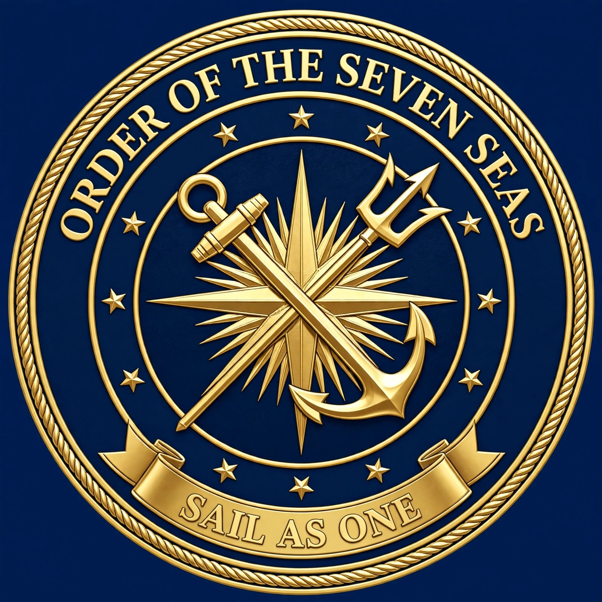

<!DOCTYPE html>
<html lang="en">
<head>
<meta charset="UTF-8">
<meta name="viewport" content="width=device-width, initial-scale=1.0">
<title>FOSS - Fraternal Order of the Seven Seas | Sail As One</title>
<link href="https://fonts.googleapis.com/css2?family=Montserrat:wght@600;800&family=Open+Sans:wght@400;600&display=swap" rel="stylesheet">

</head>
<body>
<header>

<h1>ORDER OF THE SEVEN SEAS</h1>

SAIL AS ONE • FOSS

Fraternal Order of the Seven Seas | Maritime Brotherhood, Leadership & Community Platform Est. Cebu, Philippines

 
<a href="#about" class="btn btn-gold">Explore Our Brotherhood</a>
<a href="#contact" class="btn btn-outline">Contact Us</a>
</header>
<nav>
<a href="#about">About</a>
<a href="#values">Values</a>
<a href="#outreach">Community</a>
<a href="#membership">Membership</a>
<a href="#contact">Contact</a>
</nav>
<section id="about">
<h2 style="color:var(--navy);font-size:2.1rem;text-align:center">Who We Are</h2>

The <strong>Fraternal Order of the Seven Seas (FOSS)</strong> is a fraternity anchored in brotherhood, integrity, and service to humanity.
 

<strong>Mission:</strong> To foster a brotherhood of principled leaders who lead through service, uplift communities, and sail as one.
 

<strong>Vision:</strong> A united fleet of compassionate leaders making kindness visible in every shore we touch.

</section>
<section id="values" style="background:#eef2f7;border-radius:20px">
<h2 style="color:var(--navy);font-size:2.1rem;text-align:center">Anchored in Values</h2>

<h3>⚓ Compassion</h3>
Serving with heart

<h3>🤝 Humility</h3>
Leading by serving

<h3>🧭 Integrity</h3>
True north in all we do

<h3>🌊 Brotherhood</h3>
One Fleet, One Family

</section>
<section id="outreach">
<h2 style="color:var(--navy);font-size:2.1rem;text-align:center">Community Outreach</h2>

"Be the reason someone believes that goodness still exists in this world."

 

We believe that kindness, no matter how small, can create meaningful change. Through reaching out to our communities, supporting those in need, and extending a helping hand, may we keep serving with compassion, humility, and integrity.

</section>
<section id="contact">
<h2 style="color:var(--navy);font-size:2.1rem;text-align:center">Contact</h2>

<strong>Email:</strong> orderofthesevenseas@gmail.com

<strong>Location:</strong> Cebu, Philippines

<strong>Facebook:</strong> Fraternal Order of the Seven Seas - FOSS

</section>
<footer>
<h3 style="color:var(--gold)">ORDER OF THE SEVEN SEAS</h3>

SAIL AS ONE

 

© 2026 FOSS - Fraternal Order of the Seven Seas

</footer>
</body>
</html>
